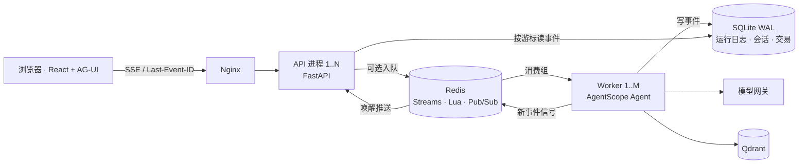

# Voyacart · 跨境电商选购 Agent

用中文说出用途、预算和收货地，Voyacart 的 Agent 会检索美国、西班牙、日本三个 Amazon 站点的商品，算出寄到目的地、含运费和税的到手价，帮你比较，并生成确认单。你在页面上批准后，它才会下单。

单轮 Agent 运行要几秒到几十秒，所以本项目的重点在后端运行时：流式长任务断线后能续传，能扩展到多个进程，交易保持一致。每一项都配有可复现的测试、压测和故障演练证据。

> 默认商品目录是 12,299 件 Amazon ESCI 真实商品（美国 5,140、西班牙 3,391、日本 3,768），标题、描述和要点保留原文。价格、库存和配送范围是按固定种子合成的演示数据。订单写入本地账本，不接入真实支付和物流。

## 后端设计要点

| 能力 | 做法 | 验证证据 |
|---|---|---|
| 可恢复的流式运行 | Agent 运行与 HTTP 连接解耦：<br>• 事件按 `runId:seq` 写入 SQLite（WAL 模式）的运行日志，SSE 断线后凭 `Last-Event-ID` 续传；<br>• 运行持有 30 秒租约、每 5 秒心跳，以 owner 作为 fencing token，拒绝过期写入；<br>• 进程重启时，为未完成的运行补齐终止事件 | API 停机演练：客户端经 Nginx 切换到另一实例，[168 条事件连续、无重复](eval/verification/2026-10-14-r2-api/report.json) |
| 运行入队与多进程扩展 | • 运行可选进入 Redis Streams 消费组，XAUTOCLAIM 回收超时任务，投递 3 次仍失败则转入死信；<br>• 一段 Lua 脚本原子完成指纹去重和待处理上限背压，超限返回 503 和 `Retry-After`；<br>• 重投按 `runId` 复用已有运行；Redis 故障时回退到进程内执行；<br>• 可用 Nginx `least_conn` 部署多 API、多 worker | [worker 被 `kill -9` 后](eval/verification/2026-10-14-r2-worker-clock/report.json)，租约到期 0.25 秒内标记中断，重投不重复调用模型 |
| 推送路径锁竞争 | 原来每个 SSE 连接每 150ms 抢一次整库写锁。改为只读连接读取事件，新事件经 Redis Pub/Sub 唤醒推送；Redis 不可用时退回轮询 | 写锁被占用时，[读等待从约 399ms 降到 0.56ms](docs/改动记录/2026-10-14/C1-推送路径优化.md)（单路径检查） |
| 交易一致性与防超卖 | • 模型只能生成确认单，买家通过 HTTP 批准后才落单；<br>• 确认单带快照指纹、300 秒过期和唯一操作号，保证幂等；<br>• 库存按 `stock >= qty` 条件扣减，任一 SKU 不足则整单回滚 | [500 个并发批准抢 100 件库存](eval/verification/2026-10-14-r2-hotspot-direct/report.json)：恰好成交 100 单，库存归零，没有负数 |
| 限流、熔断与模型容灾 | • 多进程共享模型网关配额：Redis Lua 实现带租约的分布式信号量加最小请求间隔，Redis 故障时拒绝调用；<br>• 工具级熔断：3 次失败打开，60 秒后半开探测，可经 Redis 共享；<br>• 主模型按 6 秒、18 秒退避重试后切换回退模型 | [三进程共享熔断](eval/verification/2026-10-14-r2-shared-tool-breaker/README.md)；[模型 429/5xx 回退](eval/verification/2026-10-14-r2-model-status-drill/report.json) |
| 压测与故障演练 | OpenAI 兼容的假模型（流式工具调用，可注入 429），配合 Locust SSE 压测：10% 用户断线后带游标重连，并校验事件序号 | 6 项故障演练全部通过：worker 崩溃、API 停机、Redis 停启、嵌入服务停止、模型 429/5xx、热点库存。见 [演练记录](docs/改动记录/2026-10-14/R2-真实故障演练.md) |

压测的阶段结论：单 API 进程在 64 并发下错误率为 11.85%，原因是 SQLite 写锁冲突。完整容量矩阵尚未跑完，见 [阶段报告](eval/verification/2026-10-14-r1-final-partial-report/README.md)。

## 检索与评测

**多级降级检索。** BM25 与向量召回经 RRF 融合后精排；预算、配送地、库存、材质等硬约束在代码层过滤，候选不足时自动扩大召回。依赖故障时逐级降级：

| 级别 | 方式 | 依赖 |
|---|---|---|
| 1 | 远端向量 → Qdrant → 精排 | 嵌入服务、精排服务 |
| 2 | 远端向量 → Qdrant | 嵌入服务 |
| 3 | 本地多语种向量（fastembed） | 本机 CPU，开关 `LOCAL_EMBEDDING_FALLBACK=1` |
| 4 | 关键词 2-gram | 无 |

**ESCI 真实数据评测。** 采用 Amazon ESCI（KDD Cup 2022）的人工四档相关性标注。在开发集上选定并冻结策略，留出集只运行一次。

评测口径：

- 商品库 12,299 件，包含 S/C/I 难负例，类目和材质由模型批量增强得出；
- 留出集为 300 条 ESCI test 查询；
- 策略是 `embedding_only`，嵌入模型为 `text-embedding-v4`；
- 评测日期 2026-10-15。

| 指标 | 结果 |
|---|---|
| 分级 nDCG@10（E/S/C/I = 1 / 0.1 / 0.01 / 0） | **0.613** |
| Exact Recall@50 | **0.800** |
| 硬约束泄漏（目的地、价格、库存） | **0** / 300 |
| 中文查询在远端嵌入故障时的 Recall@50 | 本地向量兜底 0.369，关键词兜底 0.173 |

完整报告、分站点结果和失败样本见 [ESCI 正式评测报告 v2](eval/verification/2026-10-15-esci-formal-eval-v2/README.md)。v1 使用查询预分类的代理类目，结果相近（nDCG@10 0.612、Recall@50 0.803），见 [v1 报告](eval/verification/2026-10-15-esci-formal-eval/README.md)。

**Agent 回归。** Harness 有 48 个场景，覆盖确定性安全契约和真实模型冒烟两档，用来检查上下文治理、工具合同和调用计量的改动。

## 架构



默认情况下，运行在 API 进程内执行，只依赖 SQLite 和本地嵌入式 Qdrant。Redis、Qdrant 服务端、入队和共享熔断都由开关打开；任何一项依赖不可用时，按既有的降级路径继续工作。

## 技术栈

| 层 | 选型 |
|---|---|
| 后端 | Python 3.11–3.13、FastAPI、AgentScope 2.0.8、AG-UI 协议、SQLite（WAL）、Redis（可选）、Qdrant、OpenTelemetry / Langfuse（可选） |
| 前端 | React 18、TypeScript、Vite、`@ag-ui/client`、Vitest |
| 部署与测试 | Docker Compose、Nginx、pytest、Locust |

## 快速开始

需要 Python 3.11–3.13、[uv](https://docs.astral.sh/uv/)、Node.js 22，以及一个兼容 OpenAI 协议、支持工具调用和流式输出的模型服务。

```bash
uv sync --frozen
npm --prefix frontend ci
cp .env.example .env    # 填写 LLM_BASE_URL、LLM_API_KEY、LLM_MODEL
```

启动后端和前端，各占一个终端：

```bash
uv run python -m uvicorn app.presentation.server:app --host 127.0.0.1 --port 8000 --workers 1
npm --prefix frontend run dev -- --host 127.0.0.1 --port 5173 --strictPort
```

打开 http://127.0.0.1:5173 。健康检查：`curl --fail http://127.0.0.1:8000/health`；接口文档在 http://127.0.0.1:8000/docs 。

首次启动会为默认目录建立商品向量索引，需要嵌入服务可用；也可以提前单独补齐，已有相同文本和模型的向量会直接复用：

```bash
uv run python -m scripts.sync_product_vectors --report eval/verification/<新目录>/sync-report.json
```

### Docker Compose

单机版本包含 API、worker、Redis、Qdrant 和 Nginx 静态前端：

```bash
docker compose --env-file .env -f docker/docker-compose.yaml up -d --build
```

多进程版本包含 Nginx、多个 API、多个队列 worker 和自动化 worker，页面地址是 http://localhost:8080 ：

```bash
docker compose --env-file .env -f docker/docker-compose.scale.yaml up -d --build --scale api=2 --scale worker=2
```

不想调用付费模型时，可以改用内置的假模型。它提供流式回复、工具调用和确定性嵌入，参数见 `scripts/loadtest/mock_llm.py`：

```bash
LLM_BASE_URL=http://mock-llm:8081/v1 LLM_API_KEY=local-model LLM_MODEL=mock-chat \
EMBEDDING_BASE_URL=http://mock-llm:8081/v1 EMBEDDING_API_KEY=local-model \
LLM_FALLBACK_MODEL= \
docker compose -f docker/docker-compose.scale.yaml --profile mock up -d --build --scale api=2 --scale worker=2
```

停止服务用 `down`；不要加 `-v`，否则会删除数据卷。

## 主要配置

完整默认值见 [`app/infrastructure/settings.py`](app/infrastructure/settings.py)，示例见 [`.env.example`](.env.example)。

| 变量 | 作用 |
|---|---|
| `LLM_BASE_URL` / `LLM_API_KEY` / `LLM_MODEL` | 主模型，必填 |
| `LLM_FALLBACK_MODEL` | 回退模型，留空则关闭回退 |
| `EMBEDDING_BASE_URL` / `EMBEDDING_API_KEY` / `EMBEDDING_MODEL` | 嵌入服务，默认复用主模型网关 |
| `RERANKER_BASE_URL` / `RERANKER_MODEL` | 精排服务，不配置时使用向量排序 |
| `QDRANT_URL` | 留空时使用本地嵌入式 Qdrant；多进程部署必须使用服务端 |
| `REDIS_URL` / `QUEUE_ENABLED` / `WORKER_CONCURRENCY` | 缓存、共享限流和队列 |
| `AGUI_QUEUE_ENABLED` / `AGUI_QUEUE_MAX_PENDING` | 运行入队（默认关闭），以及待处理上限（默认 200） |
| `AGUI_DELTA_COALESCE_MS` | 合并连续的流式增量，默认 0（不合并） |
| `BREAKER_SHARED` | 熔断状态是否经 Redis 跨进程共享 |
| `LOCAL_EMBEDDING_FALLBACK` | 本地多语种向量兜底，默认关闭 |
| `LLM_MAX_CONCURRENCY` / `LLM_MIN_INTERVAL_SECONDS` | 模型网关的并发上限和最小请求间隔 |
| `IDENTITY_MODE` | `demo`（默认）或 `hmac` 签名身份 |

所有 `VITE_*` 变量都会进入浏览器构建产物，不要在里面放密钥。

## 测试与评测

```bash
# 后端测试（用占位凭据，不调用真实模型）
LLM_API_KEY=unit-test-key LLM_BASE_URL=http://127.0.0.1:1/v1 LLM_MODEL=unit-test uv run python -m pytest -q

# 前端测试
npm --prefix frontend test

# Harness：确定性安全契约（离线），以及安全契约 + 真实模型冒烟
make eval-harness-contracts
make eval-harness

# ESCI 开发档评测（需要先准备 data/catalog-esci-v1.jsonl.gz 和 eval/esci/）
uv run python -m scripts.eval.run_esci --output eval/verification/<新目录>
```

压测脚本和容量矩阵见 `scripts/loadtest/`：

- `locustfile.py`：SSE 全程压测与断线续传校验；
- `hotspot.py`：热点库存竞争；
- `matrix.py`：API 与 worker 进程数的容量矩阵。

每次评测和压测都写入新的 `eval/verification/` 目录，保留原始日志和失败样本。

## 目录结构

```text
app/
  domain/            实体与端口（会话、交易、队列、检索）
  application/       Agent、用例、Harness 断言、运行时
  infrastructure/    持久化、Redis 队列、限流熔断、检索、上下文治理、追踪
  presentation/      FastAPI 路由、AG-UI SSE、确认单接口
frontend/            React 前端（AG-UI 客户端与断线续传）
scripts/             ESCI 数据管线、评测入口、压测与故障演练
eval/                Harness 场景、ESCI 评测集、verification 证据
docker/              单机与多进程 Compose、Nginx 配置
docs/                设计、执行计划、改造总结与按日改动记录
```

## 设计文档

- [改造设计](docs/DESIGN.md)和[执行计划](docs/PLAN.md)：数据、前端、高并发三部分的方案与任务卡
- [改造总结](docs/改造总结.md)：各项任务的完成状态、实测数字和证据索引
- [改动记录](docs/改动记录/README.md)：按日期记录需求、变更、验证和未完成项

## 当前局限

- 完整容量矩阵与改造前后的同口径性能对比尚未完成。
- ESCI 类目来自模型批量增强，与单件增强结果的类目一致率为 78.5%。类目和译文的人工抽检尚未执行，类目准确率未知。
- CI 中的真实模型评测需要配置 `HARNESS_LLM_API_KEY` 和 `HARNESS_LLM_BASE_URL` 两个 secrets。未配置时这项检查明确失败，不会静默跳过。

## 项目来源

本项目基于一个开源的电商 Agent 课程工程二次开发。在此基础上，重点改造了运行时并发与可恢复执行、ESCI 真实数据评测和商品卡前端，并补充了压测与故障演练。
