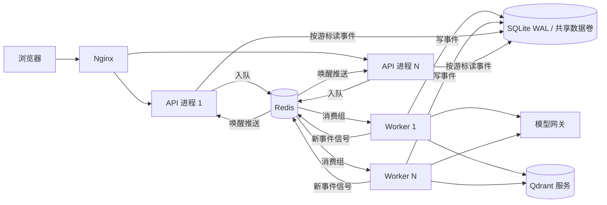

# Voyacart 改造设计

| 版本 | 日期 | 内容 |
|---|---|---|
| v1 | 2026-10-14 | 初稿：数据换成 Amazon ESCI、前端展示层重写、高并发与一致性改造 |
| v1.1 | 2026-10-14 | 补齐落地参数，拆出执行计划 [PLAN.md](PLAN.md) |
| v2 | 2026-10-14 | 范围调整：后端框架与全部降级兜底保留；前端只重做商品卡；高并发改为在现有框架内增量完成；新增跨语种检索兜底；PostgreSQL 迁移推迟到压测证明需要之后 |

## 1. 目标与原则

保留跨境电商选购场景：中国买家用中文描述需求，Agent 检索美国、西班牙、日本三个亚马逊站点的商品，比较到手价，经确认单下单。

本次做三件事：

1. **数据**：商品目录换成 Amazon ESCI 的真实商品；检索评测改用 ESCI 人工标注和分级 nDCG；补上中文查外文商品时的检索兜底。
2. **前端**：只重做商品卡，包括候选卡片、对话内的商品结果、详情、比较和历史批次。其余页面不动。
3. **高并发**：在现有框架内增量完成，包括四项：
   - 单机多进程扩展；
   - 事件推送路径优化；
   - AG-UI 运行可以选择走现有的 Redis Streams 队列；
   - 压测与故障演练。

**原则**：
- **后端框架不改。** 以下全部保留：
  - 分层结构；
  - SQLite 默认存储；
  - "Redis 不配就降级"；
  - 旧的 `/commerce/intents` 入口；
  - 语义缓存；
  - JSON 文件模式。
- **现有降级兜底一条不删**，清单见 2.5 节。
- **新增能力都带开关。** 开关关闭时，行为与现在完全一致。
- **新增两条兜底**：
  - 嵌入服务不可用时，改用本地多语种向量检索；
  - 运行队列不可用时，退回到 API 进程内直接执行。

**本次不做**：
- ACP/UCP 结账、深度研究模块；
- 真实支付和物流、商品图片；
- 商品卡以外的前端页面；
- PostgreSQL 迁移（什么情况下再做，见 5.7 节）。

## 2. 现状要点

以下事实来自 2026-10-14 的代码，对应提交 `ddd7e5b`。

### 2.1 原数据与原评测

**数据全部是合成的**：
- `catalog-v1`：500 件虚构品牌商品，例如 Wanderlite、Nomadica、Atlas-00。`external_product_id` 形如 `amazon-P1001`，也是编的。
- `catalog-v2`：由 `generate_catalog_fixture.py` 从 v1 扩到 1,000 件，覆盖 4 个平台、5 种货币。
- `catalog-v3`：由 `generate_catalog_multilingual.py` 在 v2 基础上再加 2,700 件多语种合成商品。
- 知识库：由 `generate_knowledge_fixture.py` 生成，`manifest.jsonl` 里标注为"合成演示，不用于实时法规结论"。
- 商品图：3 张由图像生成工具绘制，标注为"商品示意图"。
- 订单与库存：本地账本。

**评测分五层**：

| 层 | 数据 | 怎么判对错 |
|---|---|---|
| 商品检索 | v1 150 条（脚本由 catalog-v1 生成，开发集与发布集按 7:3 划分）；v2 72 条手写意图；v3 616 条多语种 | Recall、Precision、MRR、nDCG@k。金标是生成脚本指定的商品，或与查询同属一个"评测家族"的商品 |
| 知识检索 | 50 条，另有品类召回集 | 金标是文档文件名，门槛 0.85，包含"应当拒答"的用例 |
| Agent 回归 | `agent_cases.yaml` 100 条模板用例，覆盖 7 类场景：检索推荐、比价、下单、多轮记忆、长上下文、安全、工具失败 | 程序断言：必须调用的工具、禁止调用的工具、确认前不得产生订单、商品命中。再由 LLM 裁判按 P0 事实、P1 行为、P2 表达三级打分 |
| Harness | 48 个场景（上下文层 40 个，Agent 层 8 个），分冒烟、开发、发布三档 | 检查事实是否包含、是否核验了当前状态、SKU 价格。发布门禁看：失败数、契约测试、源码是否稳定、P95 延迟比 ≤ 1.15、token 用量是否完整 |
| 专项 | 上下文（开发 108 次、留出 252 次、成本复核 36 次、盲评）；Skill 600 条；策略学习 72 次 | 各自出报告 |

**主要局限：标注和数据出自同一批生成脚本，属于自产自评。** 测到的是"系统与生成规则吻合到什么程度"，而不是对真实用户需求的检索质量。证据是：最朴素的关键词基线 `keyword_2gram` 在 v1 上就拿到了 Recall 0.88、nDCG 0.88，说明查询与商品文本字面高度重合，评测分不出检索策略的强弱。

另外，Harness 发布档把目标设成了提示词缓存收益，这要求定价已核实。而 `suite.json` 里是 `pricing.verified=false`，所以按当前配置，发布门禁必然不通过。

### 2.2 与换数据相关的代码事实

- 商品目录路径写死在 `seed_products.py:30-38`。
- 商品 ID 格式 `P\d{4,}` 写死在约 15 处，例如 `product_search_spec.py:34`、`catalog_search.py:165`、`context_governance.py`、`visible_evidence.py`。
- `category` 既是硬过滤条件，也是查关税表的键。检索工具只认 8 个中文类目（`product_search_tool.py:27-59`）。
- 关税只看类目和目的地，目的地限 CN/US/EU/JP/SG（`tariff_schedule.py:19-25`）。货币支持 USD/EUR/JPY。
- 模型能看到的商品字段见 `context_evidence.py:119`：包含 `highlights`，不包含 `description`。
- 检索降级顺序是：向量 + 精排 → 纯向量 → `keyword_2gram`。后两级都靠字面重合，所以中文查询遇到外文商品时，只要嵌入服务故障，就一件商品也查不到。
- 仓库里已经有本地多语种嵌入实现 `scripts/eval/local_multilingual_embedding.py`（fastembed + `paraphrase-multilingual-MiniLM-L12-v2`），实现了 `EmbeddingClient` 端口，目前只在评测中使用。
- Harness 的 48 个场景使用自带的 fixture 和 `catalog-v1.jsonl`，与 catalog-v3 无关。

### 2.3 运行链路

- **执行位置**：`POST /commerce/ag-ui/run` 在 API 进程内用 `asyncio.create_task` 执行（`agent_runtime.py:60-64`），不走队列。自动化 worker 也是调用同一个 `AGUIRuntime.start` 在自己的进程里执行，再由 API 从 SQLite 读取事件推给前端。也就是说，"在别的进程执行、由 API 推送"这条路径已经存在。
- **写入方式**：每个 AG-UI 事件写一行，逐 token 的增量也各写一行（`ag_ui_journal.py:276-278`）。每写一批，还要整体重写运行投影和会话消息 JSON（`:283-287`）。
- **推送方式**：靠轮询。每个 SSE 连接每 150ms 新开一个 SQLite 连接，执行 `BEGIN IMMEDIATE` 拿整库写锁，再跑一遍过期恢复（`ag_ui.py:149-159`，`ag_ui_journal.py:333-341`）。连接越多，写锁竞争越重。这是当前最直接的并发瓶颈。
- **已有、可以沿用的机制**：
  - 运行级租约 30 秒，心跳 5 秒；
  - `stop_requested` 支持跨进程停止；
  - 会话 fence/revision 的 CAS 校验；
  - 同一会话同时只允许一个运行中运行；
  - 遇到人工审批时结束本轮运行，审批结果由下一次运行带入。
- **旧入口的 Redis Streams 队列已经具备**：
  - 消费组；
  - 超时任务回收（XAUTOCLAIM）；
  - 投递 3 次后进死信；
  - 按指纹去重；
  - 会话租约；
  - AOF 重启恢复的测试。

### 2.4 多进程下需要处理的进程内状态

| 状态 | 位置 | 问题 |
|---|---|---|
| `SequencingTracker` | `assertions.py:102`、`harness_middleware.py:79-91` | 按会话记录已调用的工具，用来硬拒"没检索就下单"。同一会话的下一轮落到别的进程时，历史缺失，可能误拒；这个字典也从不清理 |
| 嵌入式自动化循环 | `composition.py:158-163` | 每个进程都会启动一份 |
| 本地熔断 | `resilience.py:60-65` | 多进程时要打开现有的 `BREAKER_SHARED` |
| 嵌入式 Qdrant | `qdrant_product_index.py:29-34` | 有进程锁，多进程时必须改用服务端（现有规则） |
| 上下文整理的忙碌判断 | `context_service.py:120-129` | 只看本进程的锁。`context_operations` 有版本 CAS，需要核实并发整理时是否只执行一次 |

### 2.5 现有降级兜底（必须保留）

| 领域 | 兜底 |
|---|---|
| 模型 | 主模型失败切回退模型；重试与恢复（`model_recovery.py`）；熔断，可跨实例共享；网关限流（Redis 共享模式下 Redis 故障即拒绝）；生成中可取消 |
| 检索 | 精排失败退回向量排序；向量失败或无结果退回关键词；精确 ID 直接查目录；预算等硬约束由代码过滤 |
| 依赖缺失 | 无 Redis 时不用缓存、队列和事件背板；无 Qdrant 服务时用本地嵌入式；未配 `DATABASE_URL` 时用 SQLite；`file` 模式用 JSON；无 Langfuse 时不导出追踪；无 Tavily 时不注册联网搜索 |
| 运行 | 断线后按游标续传；重启时把未完成的运行标为中断；租约与 fencing；跨进程停止 |
| 交易 | 确认单快照校验；幂等操作号；确认单过期；库存条件扣减；失败时整单回滚 |
| 上下文 | 预算不足时按规则收口回复；先裁剪再摘要；证据可回查 |
| 队列 | 回收超时任务；死信；终态归档；按指纹去重 |
| Harness | 循环检测、漂移检测、工具调用顺序断言 |

## 3. 数据：Amazon ESCI

### 3.1 为什么用 ESCI

ESCI（Shopping Queries Dataset，amazon-science/esci-data，Apache-2.0）是 KDD Cup 2022 的公开基准：
- 13 万条真实查询；
- 262 万条人工相关性标注，分四档：Exact、Substitute、Complement、Irrelevant；
- 覆盖英语（美国站）、西班牙语（西班牙站）、日语（日本站）。

它正好补上 2.1 节说的"自产自评"缺陷。

ESCI 只有商品文本：标题、描述、要点、品牌、颜色。价格、库存、配送范围、图片都没有，这些由 3.4 节的合成规则补齐，并在数据里标明来源。

### 3.2 子集构建

新增 `scripts/esci/`。给定相同的输入和缓存，输出逐字节一致。步骤如下：

1. **下载原始数据**：parquet 文件下到 `data/raw/esci/`，不入库；记录文件大小和内容指纹。
2. **限定范围**：只用 `small_version` 的样本，与 KDD Cup 任务一保持一致。
3. **查询预分类**：用当前网关模型（温度 0，输出 JSON）把查询文本判到 8 个中文类目之一或"其他"，结果缓存下来。
4. **抽样查询**：
   - 只在预分类属于 8 个类目的查询里抽；
   - 按站点和类目分层，先抽目标数量的 1.3 倍；
   - 开发集目标 300 条，取自 ESCI 的 train 划分；留出集目标 900 条，取自 test 划分；
   - 站点比例为美国 : 西班牙 : 日本 = 2 : 1 : 1。
5. **商品增强**：只对抽中查询和干扰查询的已标注商品调用模型，判定类目和材质标签。结果缓存到 `data/esci/enrichment-v1.jsonl` 并入库。
6. **定稿查询**：查询的最终类目取它所有 Exact 商品类目的众数。最终类目不在 8 类内、或者没有 Exact 商品的查询剔除，再裁到目标数量。
7. **组成商品池**：选中查询的全部已标注商品（约 2.9 万件），加上 400 条干扰查询的已标注商品（约 1 万件），合计约 4 万件。
8. **合成交易字段**：规则见 3.4 节。
9. **输出**：
   - 商品目录 `data/catalog-esci-v1.jsonl.gz`；
   - 抽样记录 `data/esci/selection-v1.json`；
   - 评测集 `eval/esci/*.jsonl`。

**成本估算**：嵌入约 1,200 万 token；商品增强约 4 万次模型调用；查询预分类约 1.2 万次短调用。

### 3.3 字段映射

| 目录字段 | 来源 | 说明 |
|---|---|---|
| `product_id` | 从 `P100000` 起顺序编号 | 满足现有的 `P\d{4,}` 校验，15 处正则都不用改 |
| `external_product_id` / `canonical_product_id` | ASIN | 同一 ASIN 出现在多个站点时按它去重 |
| `source_platform` | `amazon` | |
| `source_locale` / `source_language` | `us`/`es`/`jp` 分别对应 `en`/`es`/`ja` | |
| `title`、`brand` | 原文 | |
| `highlights` | 要点前 5 条，标签为"要点"；颜色单独一条，标签为"颜色" | `highlights` 本来就在模型可见字段里，所以不用改上下文治理 |
| `description` | 去掉 HTML 后截断到 1,000 字符 | 参与向量化 |
| `category`、`material_tags` | 商品增强的结果 | 派生字段 |
| `origin_country` | 站点所在国 | 含义是发货站点，不是原产地 |
| `skus` | 每件商品只有一个 SKU | 规格取颜色，没有颜色时写"默认" |
| `data_provenance` | `{"source":"esci","synthetic":[...],"derived":[...]}` | 商品卡据此显示"演示数据"标记 |

### 3.4 合成规则

具体参数见 PLAN.md 第 1 节。
- **价格**：按类目设对数正态分布，币种随站点。
- **库存**：10% 的商品库存为 0，用来覆盖缺货过滤。
- **可配送目的地**：一定包含本地市场；CN 以 85% 的概率包含；其余目的地各以 30% 的概率包含。

合成字段只用于下单、过滤和到手价计算。检索评测的标签全部来自 ESCI 的人工标注。

### 3.5 跨语种检索与兜底链

**主路径**：继续用远端嵌入。通义 `text-embedding-v4` 本身支持多语种，是否够用，以中文派生集（3.6 节）的结果为准。
- 不达标时，在开发集上比较候选模型（例如 Qwen3-Embedding、BGE-M3）后再更换。
- 换模型时同步更新 `EMBEDDING_VERSION`，索引按现有机制增量重建。
- 配置了精排服务时，选用支持多语种的精排模型。

**新增一级兜底：本地多语种向量。** 嵌入服务失败时，先降到本地向量，再降到关键词：

| 级别 | 方式 | 依赖 |
|---|---|---|
| 1 | 远端嵌入 → Qdrant → 精排 | 嵌入服务、精排服务 |
| 2 | 远端嵌入 → Qdrant，不精排 | 嵌入服务（现有） |
| 3（新增） | 本地多语种嵌入 → Qdrant 独立集合 | 本机 CPU；把评测里的 fastembed 实现提升为运行时组件 |
| 4 | `keyword_2gram` | 无依赖（现有）；对同语种查询、品牌名、型号仍然有效 |

- **开关**：`LOCAL_EMBEDDING_FALLBACK=1`，默认关闭。关闭时只有现有的三级，行为不变。
- **本地模型选择**：在中文派生集的开发部分，比较 `paraphrase-multilingual-MiniLM-L12-v2` 与 fastembed 支持的其他多语种模型，按召回率和 CPU 单次延迟选定。
- **独立集合**：本地向量放在单独的 Qdrant 集合 `QDRANT_LOCAL_COLLECTION` 里，现有集合的结构不动。首次建索引的耗时要写进报告。

### 3.6 评测设计

| 评测集 | 内容 | 指标 |
|---|---|---|
| 排序 | 每条查询配上它已标注的商品列表，与 KDD Cup 2022 任务一口径相同 | 分级 nDCG，E/S/C/I 的增益为 1.0/0.1/0.01/0，按站点分别报告 |
| 全库召回 | 查询对 4 万件商品走完整检索链路 | Exact 商品的 Recall@10、Recall@50；分级 nDCG@10（未标注商品记 0）；judged@10（前 10 个结果里有标注的比例） |
| 硬约束 | 在留出查询上加约束：目的地、价格上限、需有货；另含约束无法满足、应返回空结果的用例 | Recall@5、Precision@5；违反约束的结果数必须为 0 |
| 中文跨语种（派生） | 从留出集取 200 条查询，用模型译成中文，人工抽检 50 条，沿用原标注 | 同全库召回，单独报告 |
| 降级 | 让嵌入服务不可用，在中文派生集上分别测第 3 级和第 4 级 | 同全库召回，与第 1 级对比 |
| Agent 级 | 新建 Harness 套件 `eval/harness/esci-v1/`，10 个基于 ESCI 商品的场景：中文找外文商品、保留硬约束、比较、下单确认、嵌入服务故障。现有的 v1 套件不动 | 沿用 Harness 现有的断言方式 |

关于 judged@10：ESCI 每条查询只标注了 20–40 个商品，商品池里没标注的商品有可能其实相关。所以全库 nDCG 偏低时，要结合 judged@10 判断：到底是检索差，还是标注有缺口。

**对照的检索策略**：`keyword_2gram`、BM25、纯向量、向量 + 精排、混合 RRF、混合 + 精排、本地向量。

**流程**：
- 参数只在开发集上调，冻结后对留出集只跑一次。
- 首次留出结果作为批准基线。之后任何一项指标比基线低 0.02 以上就阻断，沿用现有机制。

### 3.7 代码改动

1. **默认目录**：`seed_products.py` 的默认目录改为 `catalog-esci-v1.jsonl.gz`。路径收敛成一个常量，并支持 gzip。
2. **旧目录保留为历史基线**：`catalog-v1/v2/v3` 及其评测集全部保留。评测旧数据集的脚本显式指定自己的目录文件，不再读默认目录。
3. **数据门禁**：`data_quality.py` 新增一套 ESCI 门禁，检查以下几项。旧门禁继续用于旧目录。
   - 必填字段齐全，`data_provenance` 存在；
   - 三个站点和三种币种都有覆盖；
   - 8 个类目各有足量商品；
   - 缺货比例符合合成规则。
4. **提示词**：
   - 去掉重量、评分相关的说明；
   - 说明商品标题保留原文，回答用中文概括；
   - 说明价格与库存是演示数据。

   按 `AGENTS.md` 的要求，改完要跑 `make eval-harness`。
5. **商品图片接口保持原样**。新商品在图片清单里没有条目，接口按现有逻辑返回占位图；前端商品卡不再展示图片。

### 3.8 完成标准

- 构建脚本连跑两次，输出逐字节一致；ESCI 数据门禁通过。
- 类目增强人工抽检 200 条，准确率 ≥ 90%。
- 3.6 节的六组评测各有报告，开发集与留出集分开，存在 `eval/verification/` 下。
- 在中文派生集上，第 3 级兜底的 Recall@50 明显高于第 4 级，具体数字写进报告。
- 用现有的 `offline-fallback` 档在 v1 评测集上重跑，能复现 `keyword_2gram` 的基线数值，以此证明旧评测没被改动。
- 后端测试、前端测试全部通过；`make eval-harness` 通过。

## 4. 前端：只重做商品卡

**改动范围**：

| 文件 | 改动 |
|---|---|
| `ProductCards.tsx` / `compactProductCards.css` | 改成以文字为主的卡片，内容见下文 |
| `ToolProductResult.tsx` | 对话内的商品结果，使用同一套卡片 |
| `ProductDetail.tsx` / `productDetail.css` | 显示全部要点原文、各 SKU 的价格和库存、到手价明细、可配送地 |
| `ProductComparison.tsx` | 并排对比：品牌、规格、单价、到手价、库存、可配送地、前 3 条要点 |
| `ProductHistory.tsx` | 历史批次使用同一套卡片 |
| `CatalogMedia.tsx` 中的 `ProductImage` | 改成文字标识块：品牌首字母、站点徽标、类目。订单、心选等页面自动沿用 |
| `lib/commerceClient.ts`、`types.ts` | 解析新增的可选字段 `source_locale`、`source_language`、`external_product_id`、`data_provenance`；评分、重量、尺寸改为可选，缺失时不显示 |

**新卡片包含**：
- 标题原文（最多两行）；
- 站点徽标（US/ES/JP）；
- 品牌、颜色规格、前 2 条要点；
- 原币单价；
- 到手价（按目的地币种，含运费和税）；
- 库存状态；
- "演示数据"标记。

**不改的部分**：页面布局、导航、对话区，以及模型管理、自动化、Skill、偏好、订单这些页面的逻辑；现有的 CSS 体系也不动。不引入新组件库，不升级 React。

**完成标准**：
- `productContract.test.ts` 按新字段更新后通过；涉及商品卡的现有测试全部通过。
- 新增测试覆盖三种情况：缺少评分和重量的商品、"演示数据"标记、站点徽标。
- 前端构建通过。
- 以下 6 个界面各截一张图，存到 `eval/verification/`：选购、比较、详情、历史、订单、心选。

## 5. 高并发：在现有框架内增量完成

### 5.1 思路

参照 LangGraph Server 的分层（[文档](https://docs.langchain.com/langsmith/langgraph-server)）：API 负责接收请求和推送事件，worker 负责执行，Redis 只传递信号。

Voyacart 已经具备这套结构的零件：
- Redis Streams 队列、会话租约、事件背板；
- 运行日志的租约和跨进程停止；
- 自动化 worker"在别的进程执行、由 API 推送"的现成路径。

本次要做的是：把这些零件接到 AG-UI 主链路上，补上推送路径和多进程下的几处缺口，再用压测和故障演练拿到数据。存储仍是 SQLite（WAL 模式），部署形态是**单机多进程**。

Voyacart 的瓶颈在模型网关，单次运行就要几秒到几十秒。所以重点放在排队、背压、限流、长连接和断线续传上，不追求单纯的 QPS 数字。

### 5.2 推送路径优化

**读路径不再拿写锁**：
- `journal.events` 和 `journal.run` 改为只读连接，不执行 `BEGIN IMMEDIATE`，也不再顺带做过期恢复。
- 过期恢复改由每个 `AGUIRuntime` 每 5 秒执行一次，启动时也执行一次，语义不变。

**增量合并**：worker 写入时，把 50ms 窗口内同一条消息的连续 `TEXT_MESSAGE_CONTENT` 增量合成一条，工具参数增量同理。客户端拼出来的文本与合并前逐字一致。开关是 `AGUI_DELTA_COALESCE_MS`，默认 0，表示不合并。

**信号唤醒**：
- Redis 可用时，worker 每次写入后，通过现有的事件背板发布"该运行有新事件"。
- 每个 API 进程只开一条订阅，收到信号后唤醒对应的 SSE 连接去读新事件。
- 连接空闲时，每 15 秒发一次心跳注释。

Redis 不可用、或者信号丢失时，退回现在的 150ms 轮询，数据不会丢。

### 5.3 AG-UI 运行可选入队

**开关**：`AGUI_QUEUE_ENABLED=1`，同时需要 `QUEUE_ENABLED=1`。默认关闭，关闭时仍在 API 进程内执行，与现状一致。

**流程**：
1. API 校验请求后，把运行写入现有的 Redis Streams 队列，沿用按指纹去重。
2. API 返回 SSE 流，等这个运行出现在运行日志里之后再开始推送。
3. `app/worker.py` 新增 AG-UI 任务类型，消费后调用 `AGUIRuntime.start`，在 worker 进程内执行。这与自动化 worker 的做法相同。

**会话互斥**：沿用现有的 Redis 会话租约，再加上运行日志里"同一会话只有一个运行中运行"的检查。

**重投递不会重复执行**：worker 崩溃后，队列会重新投递该任务。这时运行日志里已经有同一个 `runId`，`reserve` 直接返回已有的运行，不会执行第二次。原来那次运行由租约过期恢复标为中断。

**背压**：待处理任务数超过 `AGUI_QUEUE_MAX_PENDING`（默认 200）时，返回 503，并带上 `Retry-After`。

**队列兜底**：入队失败（Redis 故障或超时）时，退回 API 进程内直接执行，同时记一条降级事件。用户照常拿到结果。

**取消**：沿用现有的 `stop_requested` 跨进程停止，最迟 5 秒内生效。

### 5.4 多进程正确性修复

| 问题 | 处理 |
|---|---|
| `SequencingTracker` | 内存字典改为持久化。在会话库新建表 `session_tool_history(session_id, tool_name)`，调用工具时写入（`INSERT OR IGNORE`），断言时按会话查询。语义不变，历史跟着会话走 |
| 自动化循环 | 多进程部署时，API 进程设 `AUTOMATION_WORKER_MODE=external`，只运行一个自动化 worker（现有选项） |
| 熔断 | 多进程部署时打开 `BREAKER_SHARED=1`（现有选项） |
| Qdrant | 多进程部署时必须配置 `QDRANT_URL`（现有规则） |
| 上下文整理 | 加一个并发测试：两个进程同时请求整理，只能执行一次。现有 CAS 能保证就不改；保证不了，就在开始整理时检查运行日志 |

**部署**：新增 `docker/docker-compose.scale.yaml`，内容如下：
- Nginx 反向代理到 N 个 API 进程；
- M 个 worker 进程，数量用 `--scale` 控制；
- Redis、Qdrant 服务；
- 所有进程共享同一个数据卷；
- 假模型服务作为可选 profile。

### 5.5 压测与故障演练

**假模型服务**：兼容 OpenAI 接口，支持流式输出和工具调用。
- 延迟模型参照 llm-d-inference-sim：首 token 延迟，加上每个 token 的间隔。
- 按脚本走固定轨迹：先检索再回答；10% 的会话走"检索 → 下单确认"。
- 同时提供 `/v1/embeddings`，返回确定性向量。
- 可以按比例注入 429 错误。

**压测脚本**：用 Locust，改写现有的 `locustfile.py`。
- 虚拟用户发起运行后消费 SSE，直到结束。记录首个事件的时间、首个文本 token 的时间、完成时间和错误码。
- 10% 的用户中途断开，带上 `Last-Event-ID` 重连，并校验事件序号连续、没有重复。

**基线**：在改动推送路径之前，用当前版本、默认配置（单进程、进程内执行）测出饱和点。

**容量矩阵**：
- API 进程 1/2/4 个 × worker 进程 1/2/4 个；
- 对比进程内执行和入队执行两种模式；
- 记录 SQLite 写锁的忙等重试次数（运行日志里已有重试循环，加个计数即可）。

**故障演练**：

| 演练 | 期望结果 |
|---|---|
| 运行中 `kill -9` 一个 worker | 该运行由租约过期恢复标为中断；队列重新投递时不重复执行 |
| 停掉一个 API 进程 | 客户端经 Nginx 重连到另一个进程，按游标续传 |
| 停掉 Redis | 入队退回进程内执行；推送退回轮询；共享限流按现有设计拒绝新的模型调用，这期间的运行以错误结束；Redis 恢复后自动回到正常路径 |
| 停掉嵌入服务 | 检索降到本地多语种向量（开关打开时）或关键词，页面仍能返回商品 |
| 主模型返回 429 或 5xx | 重试、回退模型、熔断按现有逻辑生效 |
| 500 个并发批准抢同一个库存为 100 的 SKU | 恰好成交 100 单，库存为 0，不出现负数 |

**完成标准**：

| 类别 | 标准 |
|---|---|
| 正确性（必须全部满足） | 重连前后事件序号连续、无重复；不超卖；没有确认单就没有订单；worker 崩溃后不重复执行；每项故障演练都符合期望结果 |
| 扩展性 | 在假模型下、关闭网关配额时，报告吞吐随 worker 数变化的曲线和拐点，并用写锁忙等次数和 CPU 数据解释拐点原因 |
| 前后对比 | 同一负载下，改造前后的饱和并发数和 P95 都写进报告 |

### 5.6 证据

每次压测用一个新目录 `eval/verification/<日期>-loadtest-<档位>/`，保存以下内容：
- Locust 原始 CSV；
- 运行日志统计；
- 写锁重试计数；
- 当次配置和源码指纹；
- 失败样本。

### 5.7 上限与后续：PostgreSQL

单机多进程的上限是 SQLite 的单写者锁。要扩到多台主机，需要共享数据库，本次不做迁移。

**触发条件**：压测证明写锁是拐点的主要原因，并且实际需求超过单机能力。

**届时的做法**：把运行日志、交易、会话三个热点存储做成可选的 PostgreSQL 实现。SQLite 仍是默认，所有降级路径保留。

**迁移时的注意事项**（已核实，留作参考）：
- SQLite 的整库写锁让所有"先读后写"天然串行，迁移后必须改成原子操作。已知的位置有五处：
  - 确认单决议：改用 `SELECT ... FOR UPDATE`；
  - fence 和 revision 自增：改用 `UPDATE ... RETURNING`；
  - "同一会话只有一个运行中运行"：改用部分唯一索引；
  - 运行日志追加时核对 owner 和租约：改用行锁；
  - 自动化认领：改用 advisory 锁。
- 低频存储可以统一用 SERIALIZABLE 隔离级别，冲突时自动重试，效果等同原来的整库锁。
- 租约一律用数据库的 `now()` 计时。
- Harness 和评测脚本现在按"每个场景一个数据目录"隔离，迁移后要改成"每个场景一个数据库"。

## 6. 里程碑

| 里程碑 | 内容 | 依赖 |
|---|---|---|
| M1 数据与评测 | 第 3 章 | 无 |
| M2 商品卡 | 第 4 章 | M1 |
| M3 压测底座与基线 | 假模型服务、Locust 脚本、当前版本的基线报告 | M1 |
| M4 框架内并发改造 | 5.2–5.4 节 | M3 |
| M5 压测与演练 | 5.5 节 | M4 |

M2 可以和 M3–M5 并行。每个里程碑都按 `AGENTS.md` 写改动记录；涉及提示词、工具合同或上下文的改动，要跑 `make eval-harness`。

## 7. 风险与权衡

| 风险 | 应对 |
|---|---|
| ESCI 每条查询只标注了 20–40 个商品，全库 nDCG 会被低估 | 同时报告 judged@10；排序评测只在已标注列表内计算 |
| 类目来自模型增强，又是硬过滤条件，分错就会误删商品 | 人工抽检准确率要达标；在硬约束评测里观察召回损失 |
| 亚马逊标题和要点较长，进入上下文的 token 会增加 | 要点截断到 5 条、每条 200 字符；在 Agent 级场景里观察裁剪触发次数和费用 |
| 价格、库存是合成的，可能被误认为真实数据 | 数据里记录来源，界面上显示"演示数据" |
| 单机多进程共用 SQLite，写锁是硬上限 | 用压测量化，再按 5.7 节的条件决定是否迁移 PostgreSQL |
| 每轮可能落到不同的 worker，进程内 Agent 缓存失效，每轮都要重建 | 压测中测量单轮延迟的增量，必要时按会话做亲和调度 |
| 4 万件商品在每个进程里全量加载；开混合检索时，BM25 每次查询都扫全库，会占住事件循环 | 压测时记录每个进程的内存；选混合检索作默认之前，先测它的延迟和对事件循环的阻塞 |
| 本地向量兜底占 CPU，首次建索引耗时长 | 默认关闭；开启时记录建索引耗时和单次查询延迟 |

## 8. 借鉴清单

数据取自 GitHub API，查询日期 2026-10-14。

| 项目 | Star | 最近推送 | 许可证 | 用途 |
|---|---|---|---|---|
| amazon-science/esci-data | 399 | 2026-07-02 | Apache-2.0 | 商品数据与人工标注 |
| langchain-ai/langgraph（LangGraph Server 文档） | 43,229 | 2026-10-14 | MIT | 参考其 API 与 worker 分层、Redis 只传信号的做法 |
| qdrant/fastembed | 3,243 | 2026-10-13 | Apache-2.0 | 本地多语种向量兜底（仓库已有此依赖） |
| locustio/locust | 28,202 | 2026-10-11 | MIT | 压测 |
| llm-d/llm-d-inference-sim | 214 | 2026-10-13 | Apache-2.0 | 借鉴"首 token 延迟 + token 间隔"的延迟模型。它的 README 没有提到按脚本返回工具调用，所以假模型服务自己写 |
